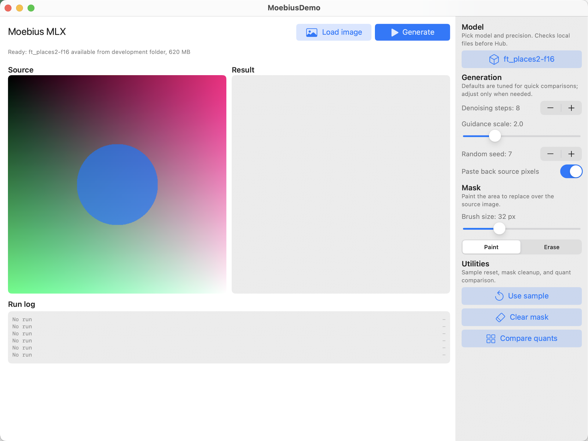

# MoebiusDemo

UIKit demo app for running Moebius-MLX on Mac Catalyst and iPadOS.



## What It Demonstrates

- Model and precision selection through the inspector panel.
- Photo Library and file-picker image loading.
- Direct mask painting over the source image, with paint and erase modes.
- One-click generation using practical defaults.
- Variant comparison for the selected model family.
- Runtime logging with model size, timing, output statistics, and memory when available.
- Hugging Face download prompts when a model is missing locally.

The main UI is intentionally image-first: source and mask editing are on the left, result display is on the right, and advanced controls live in the side inspector. On narrow devices, the inspector is presented as a slide-over panel behind a dimming overlay.

## Image Size Behavior

The released Moebius checkpoints run natively on a `512 x 512` square image and mask. The demo can import arbitrary portrait or landscape images, but it maps them into that square model workspace before generation and keeps the editable mask in the same coordinate space.

This is app-level preprocessing around the model, not arbitrary-resolution model inference. The generated result is produced from the square working image, then displayed back in the demo UI.

## Build

From the repository root:

```bash
xcodebuild -project Demo/MoebiusDemo/MoebiusDemo.xcodeproj \
  -scheme MoebiusDemo \
  -destination 'platform=macOS,variant=Mac Catalyst' \
  build
```

For iPadOS UI checks:

```bash
xcodebuild -project Demo/MoebiusDemo/MoebiusDemo.xcodeproj \
  -scheme MoebiusDemo \
  -destination 'generic/platform=iOS Simulator' \
  build
```

iOS Simulator can build and launch the UI, but it cannot execute MLX model inference. Use Mac Catalyst or a physical iPad for generation.

## Model Lookup

The demo checks these locations before offering a download:

1. Bundle resources.
2. App Application Support.
3. App Documents.
4. `MOEBIUS_MLX_MODEL_DIR`.
5. `MOEBIUS_MODEL_ROOT`.
6. The standard Hugging Face cache/materialized snapshot location.

If a model is still missing, the app prompts to download the selected Hugging Face repo and reports the expected download size when known.

## Local Development Models

For local development, point the demo at converted model artifacts with:

```bash
export MOEBIUS_MLX_MODEL_DIR=/path/to/Moebius-MLX-models
```

The directory should contain variant folders such as:

```text
ft_places2-f16/
ft_places2-q4/
pretrained-f16/
```

Each variant folder must contain `manifest.json` and the weight files referenced by that manifest.

## iPad Model Provisioning

The demo does not bundle the converted model artifacts because the full set is too large for a normal app checkout. To stage selected variants for a physical iPad:

```bash
Scripts/stage_models_for_ios.sh \
  --output /tmp/moebius-ipad-models \
  ft_places2-f16 ft_places2-q4
```

Copy the generated `Moebius-MLX` folder into the app Documents container through Finder file sharing or `devicectl`. The app has file sharing enabled and searches both `Documents/Moebius-MLX/<variant>` and `Documents/<variant>`.

## Autorun

The helper script can build, install, copy staged models, launch the app, and poll a status file:

```bash
Scripts/run_device_autorun.sh --variant ft_places2-q4
Scripts/run_device_autorun.sh --model ft_places2 --compare
```

Pass `--device` or set `MOEBIUS_DEVICE_ID` for physical-device runs.

## Source Layout

- `ViewController.swift`: screen controller and app workflow orchestration.
- `DemoMaskEditorView.swift`: source-image display and mask drawing.
- `DemoInspectorPanelView.swift`: model, generation, mask, and utility controls.
- `DemoHistoryView.swift`: run log and comparison rows.
- `DemoModelLocator.swift`: local/cache/download model availability checks.
- `DemoFixture.swift`: built-in sample image and default mask.
- `DemoAutorun.swift`: environment-driven automation for repeatable device checks.
- `DemoRunTypes.swift`: small shared model and run-state types.
