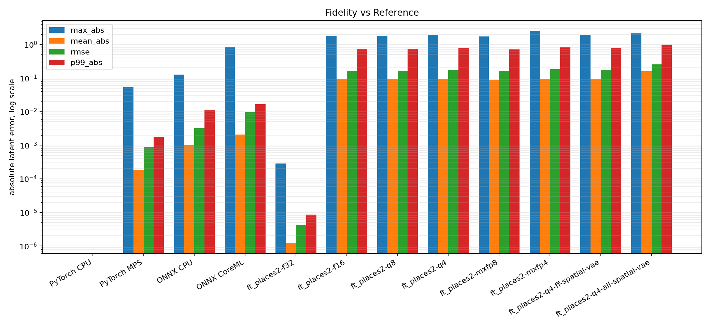
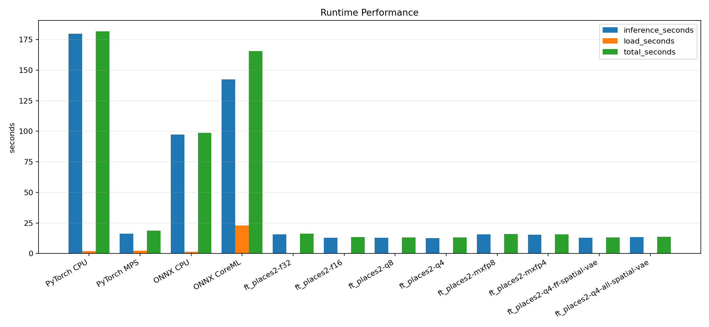
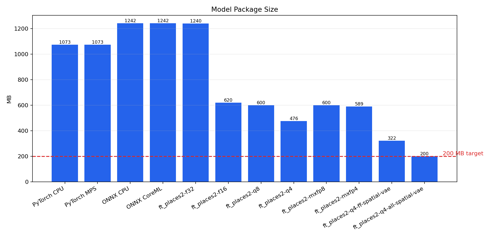
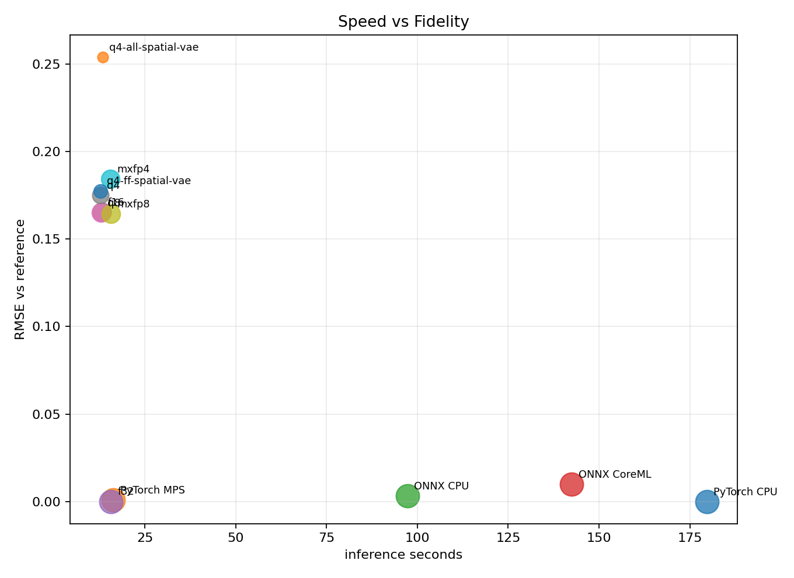
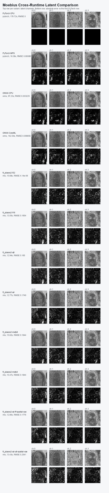

# Moebius ft_places2 Cross-Runtime Benchmark

Reference: first requested PyTorch row. Steps: `20`. Seed: `0`. Guidance: `2.0`. Strength: `0.99`.

This benchmark compares deterministic latent denoising across PyTorch, ONNX, and MLX. CPU and accelerated PyTorch/ONNX rows are reported separately so performance comparisons can be made between matching device classes. The first requested PyTorch row is used only as the numeric fidelity reference because it is the original implementation; performance comparisons should be read row-by-row by backend/device.

## Results

| name | backend | model MB | max abs | mean abs | RMSE | p99 abs | PSNR dB | cosine | inference s | load s | total s | device |
|---|---|---:|---:|---:|---:|---:|---:|---:|---:|---:|---:|---|
| PyTorch CPU | pytorch | 1072.69 | 0 | 0 | 0 | 0 | inf | 1.00000000 | 179.717 | 1.916 | 181.633 | cpu |
| PyTorch MPS | pytorch | 1072.69 | 0.055172 | 0.000183825 | 0.000897029 | 0.00176543 | 70.8283 | 0.99999955 | 16.382 | 2.247 | 18.630 | mps |
| ONNX CPU | onnx | 1241.53 | 0.125978 | 0.00101598 | 0.00322937 | 0.0109017 | 59.702 | 0.99999213 | 97.228 | 1.388 | 98.616 | CPUExecutionProvider |
| ONNX CoreML | onnx | 1241.53 | 0.841326 | 0.00207069 | 0.00985454 | 0.0165638 | 50.0117 | 0.99992732 | 142.536 | 22.982 | 165.518 | CoreMLExecutionProvider |
| ft_places2-f32 | mlx | 1239.58 | 0.00028491 | 1.23228e-06 | 4.14012e-06 | 8.706e-06 | 117.544 | 1.00000000 | 15.675 | 0.445 | 16.119 | MLX |
| ft_places2-f16 | mlx | 619.89 | 1.83459 | 0.0927747 | 0.165353 | 0.732445 | 25.516 | 0.98055822 | 13.046 | 0.307 | 13.354 | MLX |
| ft_places2-q8 | mlx | 600.23 | 1.83604 | 0.092583 | 0.165028 | 0.725383 | 25.533 | 0.98064196 | 12.937 | 0.306 | 13.243 | MLX |
| ft_places2-q4 | mlx | 475.67 | 1.95174 | 0.0946017 | 0.174932 | 0.78023 | 25.027 | 0.97803926 | 12.765 | 0.372 | 13.138 | MLX |
| ft_places2-mxfp8 | mlx | 599.56 | 1.75212 | 0.0899991 | 0.164387 | 0.710897 | 25.567 | 0.98055184 | 15.620 | 0.304 | 15.924 | MLX |
| ft_places2-mxfp4 | mlx | 589.09 | 2.52791 | 0.0963022 | 0.184424 | 0.821634 | 24.568 | 0.97593838 | 15.468 | 0.313 | 15.781 | MLX |
| ft_places2-q4-ff-spatial-vae | mlx | 322.50 | 1.96512 | 0.0965489 | 0.177565 | 0.80164 | 24.897 | 0.97712547 | 12.803 | 0.391 | 13.195 | MLX |
| ft_places2-q4-all-spatial-vae | mlx | 200.50 | 2.14916 | 0.158849 | 0.254075 | 0.979826 | 21.785 | 0.95224071 | 13.429 | 0.340 | 13.769 | MLX |

## Interpretation

- Use `PyTorch MPS` versus `MLX` rows for the Apple GPU-backed speed comparison.
- `PyTorch CPU` and `ONNX CPU` are included as explicit CPU baselines, not as the headline speed comparison.
- `ONNX CoreML` uses ONNX Runtime's CoreML provider where available. Some graph nodes can still run on CPU, and provider setup is included in `load s`.
- Fidelity metrics are measured against the first requested PyTorch row, which is the original implementation path used as a numeric reference.

## Charts










## Contact Sheet



## Files

- `benchmark.csv`: raw machine-readable benchmark rows.
- `reference_fixture/`: deterministic fixture used for MLX comparison.
- `latents/`: raw f32 latent outputs used for metrics and the contact sheet.

## Reproduce

Install benchmark dependencies:

```bash
python3 -m venv .venv
./.venv/bin/python -m pip install -r requirements-benchmarks.txt
```

Run the benchmark with local paths, or omit them to let the script download public artifacts:

```bash
./.venv/bin/python Scripts/run_cross_runtime_benchmark.py \
  --output-dir Docs/BenchmarkReports/ft_places2-cross-runtime-steps20
```

Useful path overrides:

- `--pytorch-code-root`: original Moebius Python repository.
- `--pytorch-weights-root`: Hugging Face `hustvl/Moebius` checkpoint root.
- `--vae-dir`: PixelHacker VAE directory containing `config.json` and `diffusion_pytorch_model.bin`.
- `--torch-devices`: comma-separated PyTorch devices, for example `cpu,mps`.
- `--onnx-providers`: comma-separated ONNX Runtime providers, for example `CPUExecutionProvider,CoreMLExecutionProvider`.
- `--onnx-root`: ONNX directory containing `vae_encoder.onnx` and `unet.onnx`.
- `--mlx-model-root`: directory containing MLX variant folders.
