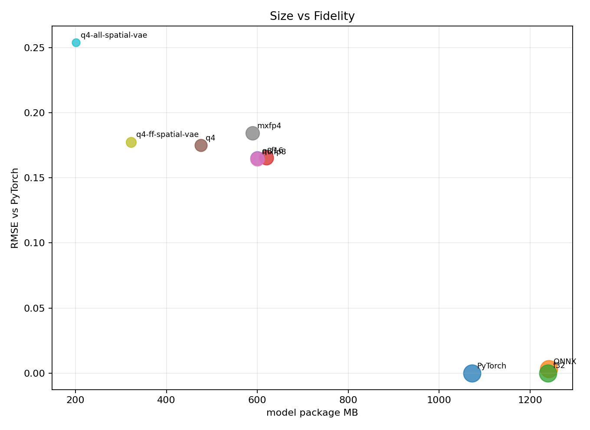

# Moebius ft_places2 Cross-Runtime Benchmark

Reference: `pytorch`. Steps: `20`. Seed: `0`. Guidance: `2.0`. Strength: `0.99`.

This benchmark compares deterministic latent denoising across PyTorch, ONNX, and MLX. PyTorch is the default reference because it is the original implementation. MLX rows consume the reference fixture generated from the PyTorch run, so those rows isolate the MLX UNet/scheduler path against the PyTorch latent inputs.

## Results

| name | backend | model MB | max abs | mean abs | RMSE | p99 abs | PSNR dB | cosine | inference s | load s | total s | device |
|---|---|---:|---:|---:|---:|---:|---:|---:|---:|---:|---:|---|
| PyTorch | pytorch | 1072.69 | 0 | 0 | 0 | 0 | inf | 1.00000000 | 183.104 | 2.030 | 185.135 | cpu |
| ONNX | onnx | 1241.53 | 0.125978 | 0.00101598 | 0.00322937 | 0.0109017 | 59.702 | 0.99999213 | 96.079 | 1.540 | 97.619 | CPUExecutionProvider |
| ft_places2-f32 | mlx | 1239.58 | 0.00028491 | 1.23228e-06 | 4.14012e-06 | 8.706e-06 | 117.544 | 1.00000000 | 17.882 | 0.433 | 18.315 | MLX |
| ft_places2-f16 | mlx | 619.89 | 1.83459 | 0.0927747 | 0.165353 | 0.732445 | 25.516 | 0.98055822 | 16.066 | 0.312 | 16.379 | MLX |
| ft_places2-q8 | mlx | 600.23 | 1.83604 | 0.092583 | 0.165028 | 0.725383 | 25.533 | 0.98064196 | 15.571 | 0.320 | 15.891 | MLX |
| ft_places2-q4 | mlx | 475.67 | 1.95174 | 0.0946017 | 0.174932 | 0.78023 | 25.027 | 0.97803926 | 15.652 | 0.380 | 16.033 | MLX |
| ft_places2-mxfp8 | mlx | 599.56 | 1.75212 | 0.0899991 | 0.164387 | 0.710897 | 25.567 | 0.98055184 | 18.609 | 0.315 | 18.924 | MLX |
| ft_places2-mxfp4 | mlx | 589.09 | 2.52791 | 0.0963022 | 0.184424 | 0.821634 | 24.568 | 0.97593838 | 18.799 | 0.314 | 19.113 | MLX |
| ft_places2-q4-ff-spatial-vae | mlx | 322.50 | 1.96512 | 0.0965489 | 0.177565 | 0.80164 | 24.897 | 0.97712547 | 15.163 | 0.395 | 15.558 | MLX |
| ft_places2-q4-all-spatial-vae | mlx | 200.50 | 2.14916 | 0.158849 | 0.254075 | 0.979826 | 21.785 | 0.95224071 | 16.824 | 0.335 | 17.159 | MLX |

## Charts




## Contact Sheet


## Files

- `benchmark.csv`: raw machine-readable benchmark rows.
- `reference_fixture/`: deterministic fixture used for MLX comparison.
- `latents/`: raw f32 latent outputs used for metrics and the contact sheet.

## Reproduce

Install benchmark dependencies:

```bash
python3 -m venv .venv
./.venv/bin/python -m pip install -r requirements-benchmarks.txt
```

Run the benchmark with local paths, or omit them to let the script download public artifacts:

```bash
./.venv/bin/python Scripts/run_cross_runtime_benchmark.py \
  --output-dir Docs/BenchmarkReports/ft_places2-cross-runtime-steps20
```

Useful path overrides:

- `--pytorch-code-root`: original Moebius Python repository.
- `--pytorch-weights-root`: Hugging Face `hustvl/Moebius` checkpoint root.
- `--vae-dir`: PixelHacker VAE directory containing `config.json` and `diffusion_pytorch_model.bin`.
- `--onnx-root`: ONNX directory containing `vae_encoder.onnx` and `unet.onnx`.
- `--mlx-model-root`: directory containing MLX variant folders.
